# RFx module — usability heuristics audit

Every screen in the RFx module, audited against Nielsen's ten heuristics. Each page has an
annotated image in `pages/` with the proposed changes marked on the screen itself.

**38 screens · 6 critical · 61 major · 71 minor · 3 patterns worth keeping**

## Finding the work

Where a buyer starts the day and turns demand into an event.

### 1 · Sourcing Board (Dashboard)

*Desktop web · category buyer · the landing screen: find the event that needs me, or start a new one.*

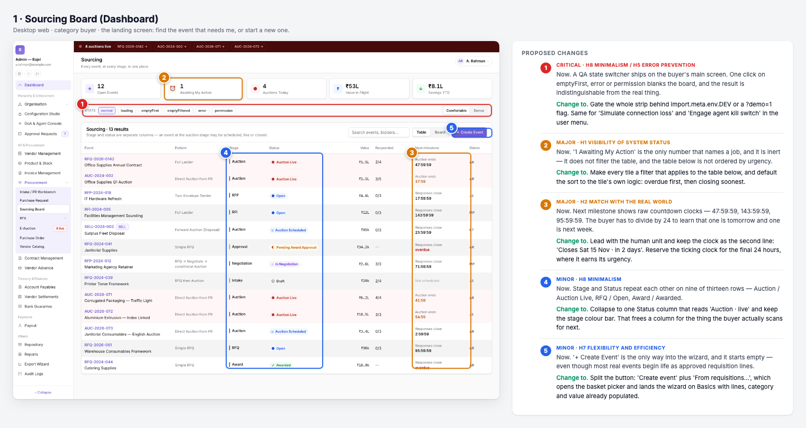

1. **Critical · H8 Minimalism / H5 Error prevention**  
   *Now.* A QA state switcher ships on the buyer's main screen. One click on emptyFirst, error or permission blanks the board, and the result is indistinguishable from the real thing.  
   *Change to.* Gate the whole strip behind import.meta.env.DEV or a ?demo=1 flag. Same for 'Simulate connection loss' and 'Engage agent kill switch' in the user menu.

2. **Major · H1 Visibility of system status**  
   *Now.* '1 Awaiting My Action' is the only number that names a job, and it is inert — it does not filter the table, and the table below is not ordered by urgency.  
   *Change to.* Make every tile a filter that applies to the table below, and default the sort to the tile's own logic: overdue first, then closing soonest.

3. **Major · H2 Match with the real world**  
   *Now.* Next milestone shows raw countdown clocks — 47:59:59, 143:59:59, 95:59:59. The buyer has to divide by 24 to learn that one is tomorrow and one is next week.  
   *Change to.* Lead with the human unit and keep the clock as the second line: 'Closes Sat 15 Nov · in 2 days'. Reserve the ticking clock for the final 24 hours, where it earns its urgency.

4. **Minor · H8 Minimalism**  
   *Now.* Stage and Status repeat each other on nine of thirteen rows — Auction / Auction Live, RFQ / Open, Award / Awarded.  
   *Change to.* Collapse to one Status column that reads 'Auction · live' and keep the stage colour bar. That frees a column for the thing the buyer actually scans for next.

5. **Minor · H7 Flexibility and efficiency**  
   *Now.* '+ Create Event' is the only way into the wizard, and it starts empty — even though most real events begin life as approved requisition lines.  
   *Change to.* Split the button: 'Create event' plus 'From requisitions…', which opens the basket picker and lands the wizard on Basics with lines, category and value already populated.

### 2 · RFX Home

*Desktop web · category buyer · the daily mission-control screen: what needs me today.*

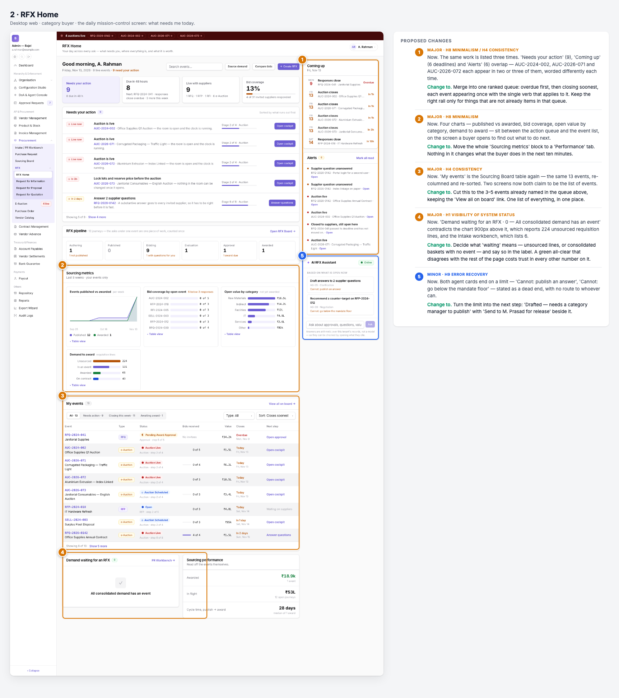

1. **Major · H8 Minimalism / H4 Consistency**  
   *Now.* The same work is listed three times. 'Needs your action' (9), 'Coming up' (6 deadlines) and 'Alerts' (6) overlap — AUC-2024-002, AUC-2026-071 and AUC-2026-072 each appear in two or three of them, worded differently each time.  
   *Change to.* Merge into one ranked queue: overdue first, then closing soonest, each event appearing once with the single verb that applies to it. Keep the right rail only for things that are not already items in that queue.

2. **Major · H8 Minimalism**  
   *Now.* Four charts — published vs awarded, bid coverage, open value by category, demand to award — sit between the action queue and the event list, on the screen a buyer opens to find out what to do next.  
   *Change to.* Move the whole 'Sourcing metrics' block to a 'Performance' tab. Nothing in it changes what the buyer does in the next ten minutes.

3. **Major · H4 Consistency**  
   *Now.* 'My events' is the Sourcing Board table again — the same 13 events, re-columned and re-sorted. Two screens now both claim to be the list of events.  
   *Change to.* Cut this to the 3–5 events already named in the queue above, keeping the 'View all on board' link. One list of everything, in one place.

4. **Major · H1 Visibility of system status**  
   *Now.* 'Demand waiting for an RFX · 0 — All consolidated demand has an event' contradicts the chart 900px above it, which reports 224 unsourced requisition lines, and the Intake workbench, which lists 6.  
   *Change to.* Decide what 'waiting' means — unsourced lines, or consolidated baskets with no event — and say so in the label. A green all-clear that disagrees with the rest of the page costs trust in every other number on it.

5. **Minor · H9 Error recovery**  
   *Now.* Both agent cards end on a limit — 'Cannot: publish an answer', 'Cannot: go below the mandate floor' — stated as a dead end, with no route to whoever can.  
   *Change to.* Turn the limit into the next step: 'Drafted — needs a category manager to publish' with 'Send to M. Prasad for release' beside it.

### 3 · Purchase Request

*Desktop web · category buyer · find approved demand and turn it into a sourcing event.*

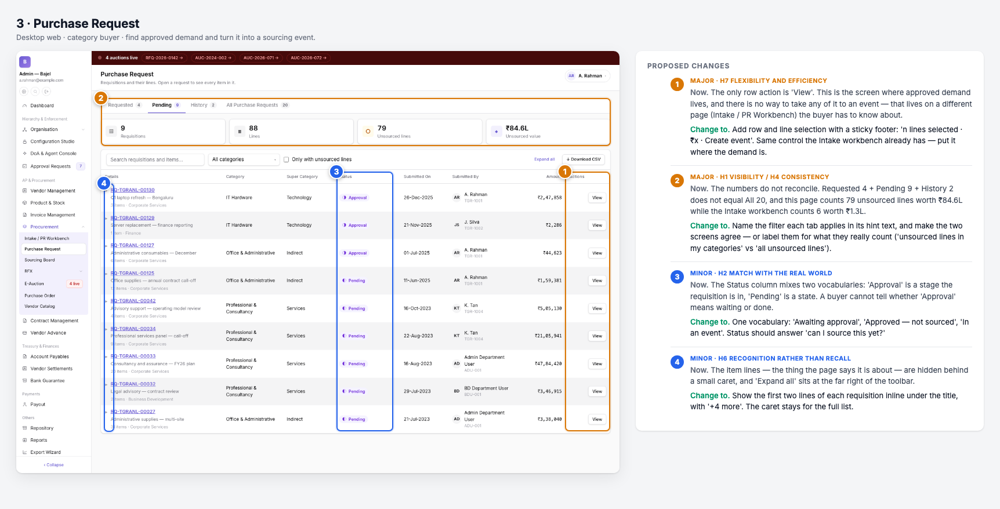

1. **Major · H7 Flexibility and efficiency**  
   *Now.* The only row action is 'View'. This is the screen where approved demand lives, and there is no way to take any of it to an event — that lives on a different page (Intake / PR Workbench) the buyer has to know about.  
   *Change to.* Add row and line selection with a sticky footer: 'n lines selected · ₹x · Create event'. Same control the Intake workbench already has — put it where the demand is.

2. **Major · H1 Visibility / H4 Consistency**  
   *Now.* The numbers do not reconcile. Requested 4 + Pending 9 + History 2 does not equal All 20, and this page counts 79 unsourced lines worth ₹84.6L while the Intake workbench counts 6 worth ₹1.3L.  
   *Change to.* Name the filter each tab applies in its hint text, and make the two screens agree — or label them for what they really count ('unsourced lines in my categories' vs 'all unsourced lines').

3. **Minor · H2 Match with the real world**  
   *Now.* The Status column mixes two vocabularies: 'Approval' is a stage the requisition is in, 'Pending' is a state. A buyer cannot tell whether 'Approval' means waiting or done.  
   *Change to.* One vocabulary: 'Awaiting approval', 'Approved — not sourced', 'In an event'. Status should answer 'can I source this yet?'

4. **Minor · H6 Recognition rather than recall**  
   *Now.* The item lines — the thing the page says it is about — are hidden behind a small caret, and 'Expand all' sits at the far right of the toolbar.  
   *Change to.* Show the first two lines of each requisition inline under the title, with '+4 more'. The caret stays for the full list.

### 4 · Intake / PR Workbench

*Desktop web · category buyer · consolidate unsourced requisition lines into one event.*

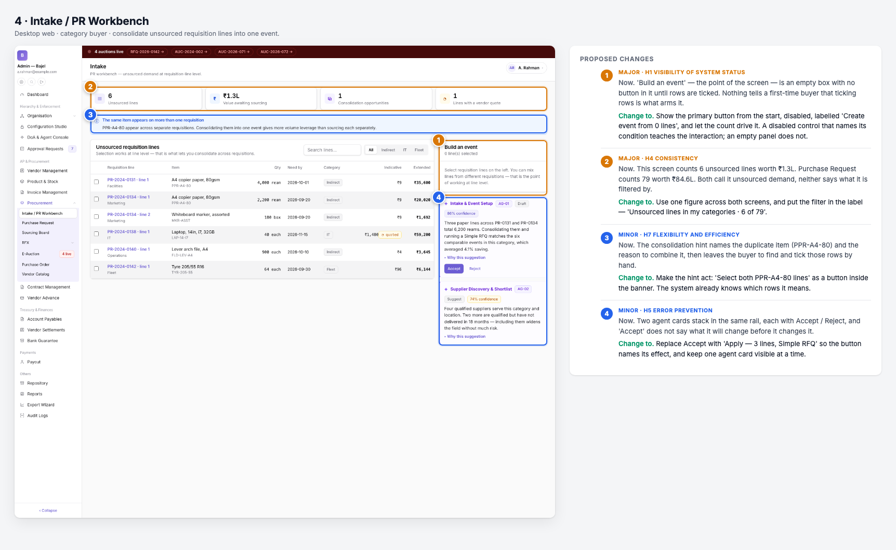

1. **Major · H1 Visibility of system status**  
   *Now.* 'Build an event' — the point of the screen — is an empty box with no button in it until rows are ticked. Nothing tells a first-time buyer that ticking rows is what arms it.  
   *Change to.* Show the primary button from the start, disabled, labelled 'Create event from 0 lines', and let the count drive it. A disabled control that names its condition teaches the interaction; an empty panel does not.

2. **Major · H4 Consistency**  
   *Now.* This screen counts 6 unsourced lines worth ₹1.3L. Purchase Request counts 79 worth ₹84.6L. Both call it unsourced demand, neither says what it is filtered by.  
   *Change to.* Use one figure across both screens, and put the filter in the label — 'Unsourced lines in my categories · 6 of 79'.

3. **Minor · H7 Flexibility and efficiency**  
   *Now.* The consolidation hint names the duplicate item (PPR-A4-80) and the reason to combine it, then leaves the buyer to find and tick those rows by hand.  
   *Change to.* Make the hint act: 'Select both PPR-A4-80 lines' as a button inside the banner. The system already knows which rows it means.

4. **Minor · H5 Error prevention**  
   *Now.* Two agent cards stack in the same rail, each with Accept / Reject, and 'Accept' does not say what it will change before it changes it.  
   *Change to.* Replace Accept with 'Apply — 3 lines, Simple RFQ' so the button names its effect, and keep one agent card visible at a time.

## Create Event wizard

The eight steps that build a sourcing event.

### 5 · Create Event — Step 1 · Basics

*Desktop web · category buyer · name the event and decide how it will run.*

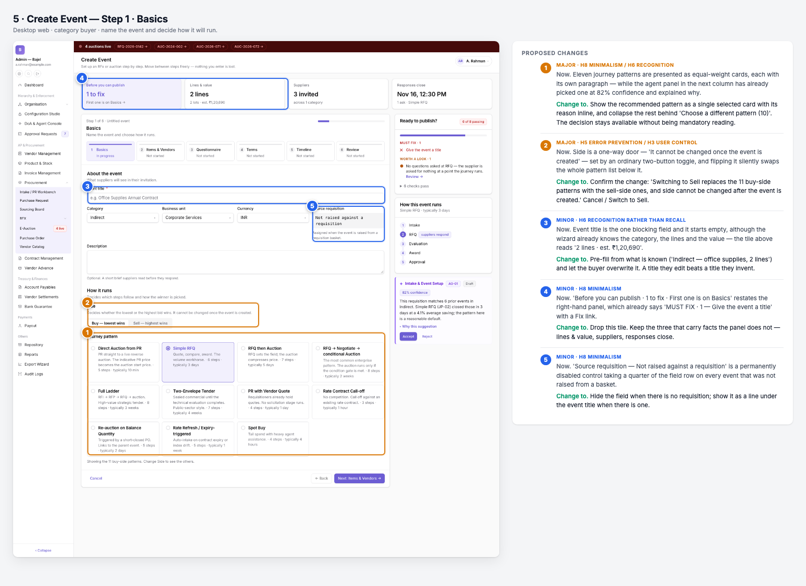

1. **Major · H8 Minimalism / H6 Recognition**  
   *Now.* Eleven journey patterns are presented as equal-weight cards, each with its own paragraph — while the agent panel in the next column has already picked one at 82% confidence and explained why.  
   *Change to.* Show the recommended pattern as a single selected card with its reason inline, and collapse the rest behind 'Choose a different pattern (10)'. The decision stays available without being mandatory reading.

2. **Major · H5 Error prevention / H3 User control**  
   *Now.* Side is a one-way door — 'It cannot be changed once the event is created' — set by an ordinary two-button toggle, and flipping it silently swaps the whole pattern list below it.  
   *Change to.* Confirm the change: 'Switching to Sell replaces the 11 buy-side patterns with the sell-side ones, and side cannot be changed after the event is created.' Cancel / Switch to Sell.

3. **Minor · H6 Recognition rather than recall**  
   *Now.* Event title is the one blocking field and it starts empty, although the wizard already knows the category, the lines and the value — the tile above reads '2 lines · est. ₹1,20,690'.  
   *Change to.* Pre-fill from what is known ('Indirect — office supplies, 2 lines') and let the buyer overwrite it. A title they edit beats a title they invent.

4. **Minor · H8 Minimalism**  
   *Now.* 'Before you can publish · 1 to fix · First one is on Basics' restates the right-hand panel, which already says 'MUST FIX · 1 — Give the event a title' with a Fix link.  
   *Change to.* Drop this tile. Keep the three that carry facts the panel does not — lines & value, suppliers, responses close.

5. **Minor · H8 Minimalism**  
   *Now.* 'Source requisition — Not raised against a requisition' is a permanently disabled control taking a quarter of the field row on every event that was not raised from a basket.  
   *Change to.* Hide the field when there is no requisition; show it as a line under the event title when there is one.

### 6 · Create Event — Step 2 · Items & Vendors

*Desktop web · category buyer · decide what is being sourced and who prices each line.*

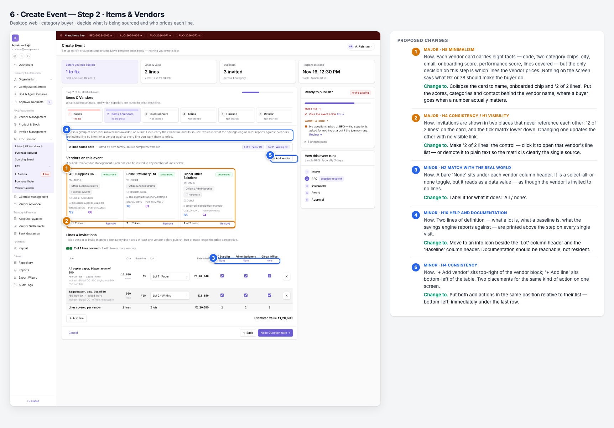

1. **Major · H8 Minimalism**  
   *Now.* Each vendor card carries eight facts — code, two category chips, city, email, onboarding score, performance score, lines covered — but the only decision on this step is which lines the vendor prices. Nothing on the screen says what 92 or 78 should make the buyer do.  
   *Change to.* Collapse the card to name, onboarded chip and '2 of 2 lines'. Put the scores, categories and contact behind the vendor name, where a buyer goes when a number actually matters.

2. **Major · H4 Consistency / H1 Visibility**  
   *Now.* Invitations are shown in two places that never reference each other: '2 of 2 lines' on the card, and the tick matrix lower down. Changing one updates the other with no visible link.  
   *Change to.* Make '2 of 2 lines' the control — click it to open that vendor's line list — or demote it to plain text so the matrix is clearly the single source.

3. **Minor · H2 Match with the real world**  
   *Now.* A bare 'None' sits under each vendor column header. It is a select-all-or-none toggle, but it reads as a data value — as though the vendor is invited to no lines.  
   *Change to.* Label it for what it does: 'All / none'.

4. **Minor · H10 Help and documentation**  
   *Now.* Two lines of definition — what a lot is, what a baseline is, what the savings engine reports against — are printed above the step on every single visit.  
   *Change to.* Move to an info icon beside the 'Lot' column header and the 'Baseline' column header. Documentation should be reachable, not resident.

5. **Minor · H4 Consistency**  
   *Now.* '+ Add vendor' sits top-right of the vendor block; '+ Add line' sits bottom-left of the table. Two placements for the same kind of action on one screen.  
   *Change to.* Put both add actions in the same position relative to their list — bottom-left, immediately under the last row.

### 7 · Create Event — Step 3 · Questionnaire

*Desktop web · category buyer · decide what suppliers must answer alongside their price.*

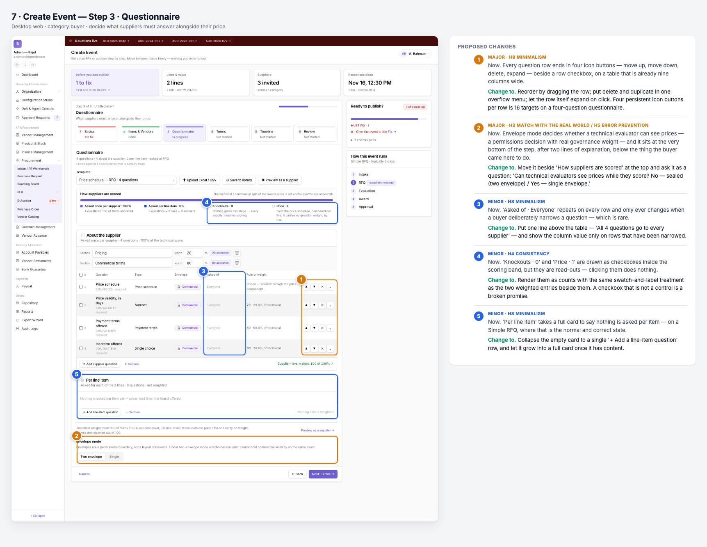

1. **Major · H8 Minimalism**  
   *Now.* Every question row ends in four icon buttons — move up, move down, delete, expand — beside a row checkbox, on a table that is already nine columns wide.  
   *Change to.* Reorder by dragging the row; put delete and duplicate in one overflow menu; let the row itself expand on click. Four persistent icon buttons per row is 16 targets on a four-question questionnaire.

2. **Major · H2 Match with the real world / H5 Error prevention**  
   *Now.* Envelope mode decides whether a technical evaluator can see prices — a permissions decision with real governance weight — and it sits at the very bottom of the step, after two lines of explanation, below the thing the buyer came here to do.  
   *Change to.* Move it beside 'How suppliers are scored' at the top and ask it as a question: 'Can technical evaluators see prices while they score? No — sealed (two envelope) / Yes — single envelope.'

3. **Minor · H8 Minimalism**  
   *Now.* 'Asked of · Everyone' repeats on every row and only ever changes when a buyer deliberately narrows a question — which is rare.  
   *Change to.* Put one line above the table — 'All 4 questions go to every supplier' — and show the column value only on rows that have been narrowed.

4. **Minor · H4 Consistency**  
   *Now.* 'Knockouts · 0' and 'Price · 1' are drawn as checkboxes inside the scoring band, but they are read-outs — clicking them does nothing.  
   *Change to.* Render them as counts with the same swatch-and-label treatment as the two weighted entries beside them. A checkbox that is not a control is a broken promise.

5. **Minor · H8 Minimalism**  
   *Now.* 'Per line item' takes a full card to say nothing is asked per item — on a Simple RFQ, where that is the normal and correct state.  
   *Change to.* Collapse the empty card to a single '+ Add a line-item question' row, and let it grow into a full card once it has content.

### 8 · Create Event — Step 4 · Terms

*Desktop web · category buyer · attach the conditions suppliers accept before they respond.*

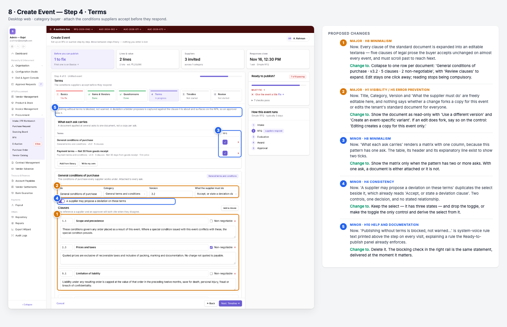

1. **Major · H8 Minimalism**  
   *Now.* Every clause of the standard document is expanded into an editable textarea — five clauses of legal prose the buyer accepts unchanged on almost every event, and must scroll past to reach Next.  
   *Change to.* Collapse to one row per document: 'General conditions of purchase · v3.2 · 5 clauses · 2 non-negotiable', with 'Review clauses' to expand. Edit stays one click away; reading stops being compulsory.

2. **Major · H1 Visibility / H5 Error prevention**  
   *Now.* Title, Category, Version and 'What the supplier must do' are freely editable here, and nothing says whether a change forks a copy for this event or edits the tenant's standard document for everyone.  
   *Change to.* Show the document as read-only with 'Use a different version' and 'Create an event-specific variant'. If an edit does fork, say so on the control: 'Editing creates a copy for this event only.'

3. **Minor · H8 Minimalism**  
   *Now.* 'What each ask carries' renders a matrix with one column, because this pattern has one ask. The table, its header and its explanatory line exist to show two ticks.  
   *Change to.* Show the matrix only when the pattern has two or more asks. With one ask, a document is either attached or it is not.

4. **Minor · H4 Consistency**  
   *Now.* 'A supplier may propose a deviation on these terms' duplicates the select beside it, which already reads 'Accept, or state a deviation clause'. Two controls, one decision, and no stated relationship.  
   *Change to.* Keep the select — it has three states — and drop the toggle, or make the toggle the only control and derive the select from it.

5. **Minor · H10 Help and documentation**  
   *Now.* 'Publishing without terms is blocked, not warned...' is system-voice rule text printed above the step on every visit, explaining a rule the Ready-to-publish panel already enforces.  
   *Change to.* Delete it. The blocking check in the right rail is the same statement, delivered at the moment it matters.

### 9 · Create Event — Step 5 · Timeline

*Desktop web · category buyer · set when each ask opens and closes.*

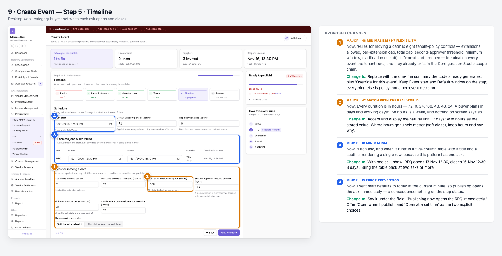

1. **Major · H8 Minimalism / H7 Flexibility**  
   *Now.* 'Rules for moving a date' is eight tenant-policy controls — extensions allowed, per-extension cap, total cap, second-approver threshold, minimum window, clarification cut-off, shift-or-absorb, reopen — identical on every event the tenant runs, and they already exist in the Configuration Studio scope chain.  
   *Change to.* Replace with the one-line summary the code already generates, plus 'Override for this event'. Keep Event start and Default window on the step; everything else is policy, not a per-event decision.

2. **Major · H2 Match with the real world**  
   *Now.* Every duration is in hours — 72, 0, 24, 168, 48, 48, 24. A buyer plans in days and working days; 168 hours is a week, and nothing on screen says so.  
   *Change to.* Accept and display the natural unit: '7 days' with hours as the stored value. Where hours genuinely matter (soft close), keep hours and say why.

3. **Minor · H8 Minimalism**  
   *Now.* 'Each ask, and when it runs' is a five-column table with a title and a subtitle, rendering a single row, because this pattern has one ask.  
   *Change to.* With one ask, show 'RFQ opens 13 Nov 12:30, closes 16 Nov 12:30 · 3 days'. Bring the table back at two asks or more.

4. **Minor · H5 Error prevention**  
   *Now.* Event start defaults to today at the current minute, so publishing opens the ask immediately — a consequence nothing on the step states.  
   *Change to.* Say it under the field: 'Publishing now opens the RFQ immediately.' Offer 'Open when I publish' and 'Open at a set time' as the two explicit choices.

### 10 · Create Event — Step 6 · Review & Publish

*Desktop web · category buyer · last check before invitations go out.*

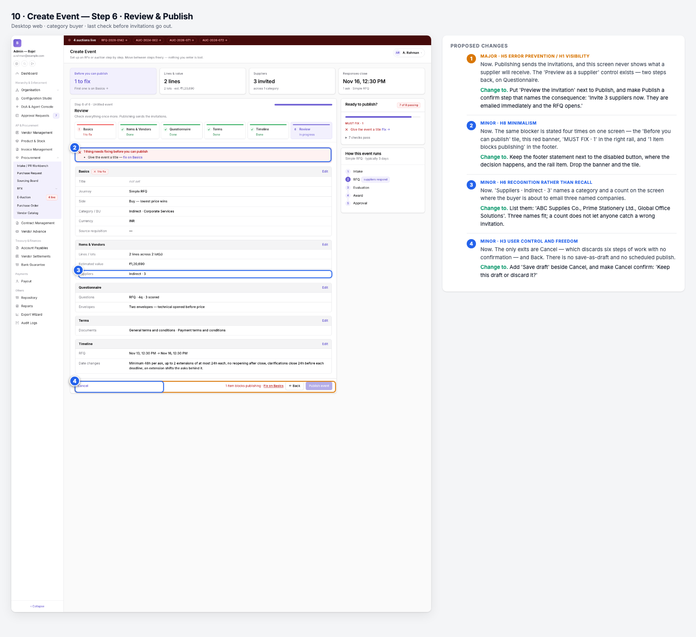

1. **Major · H5 Error prevention / H1 Visibility**  
   *Now.* Publishing sends the invitations, and this screen never shows what a supplier will receive. The 'Preview as a supplier' control exists — two steps back, on Questionnaire.  
   *Change to.* Put 'Preview the invitation' next to Publish, and make Publish a confirm step that names the consequence: 'Invite 3 suppliers now. They are emailed immediately and the RFQ opens.'

2. **Minor · H8 Minimalism**  
   *Now.* The same blocker is stated four times on one screen — the 'Before you can publish' tile, this red banner, 'MUST FIX · 1' in the right rail, and '1 item blocks publishing' in the footer.  
   *Change to.* Keep the footer statement next to the disabled button, where the decision happens, and the rail item. Drop the banner and the tile.

3. **Minor · H6 Recognition rather than recall**  
   *Now.* 'Suppliers · Indirect · 3' names a category and a count on the screen where the buyer is about to email three named companies.  
   *Change to.* List them: 'ABC Supplies Co., Prime Stationery Ltd., Global Office Solutions'. Three names fit; a count does not let anyone catch a wrong invitation.

4. **Minor · H3 User control and freedom**  
   *Now.* The only exits are Cancel — which discards six steps of work with no confirmation — and Back. There is no save-as-draft and no scheduled publish.  
   *Change to.* Add 'Save draft' beside Cancel, and make Cancel confirm: 'Keep this draft or discard it?'

### 11 · Create Event — Step · Evaluation (Full Ladder)

*Desktop web · category buyer · set how responses are screened before price is compared.*

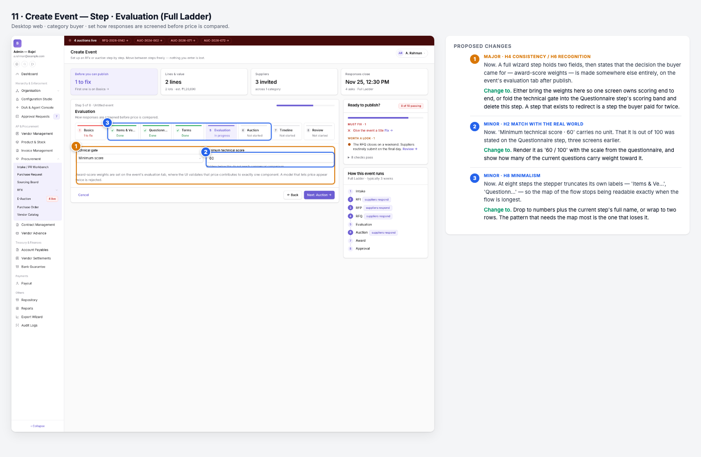

1. **Major · H4 Consistency / H6 Recognition**  
   *Now.* A full wizard step holds two fields, then states that the decision the buyer came for — award-score weights — is made somewhere else entirely, on the event's evaluation tab after publish.  
   *Change to.* Either bring the weights here so one screen owns scoring end to end, or fold the technical gate into the Questionnaire step's scoring band and delete this step. A step that exists to redirect is a step the buyer paid for twice.

2. **Minor · H2 Match with the real world**  
   *Now.* 'Minimum technical score · 60' carries no unit. That it is out of 100 was stated on the Questionnaire step, three screens earlier.  
   *Change to.* Render it as '60 / 100' with the scale from the questionnaire, and show how many of the current questions carry weight toward it.

3. **Minor · H8 Minimalism**  
   *Now.* At eight steps the stepper truncates its own labels — 'Items & Ve…', 'Questionn…' — so the map of the flow stops being readable exactly when the flow is longest.  
   *Change to.* Drop to numbers plus the current step's full name, or wrap to two rows. The pattern that needs the map most is the one that loses it.

### 12 · Create Event — Step · Auction (Full Ladder)

*Desktop web · category buyer · decide how the live auction runs and what bidders see.*

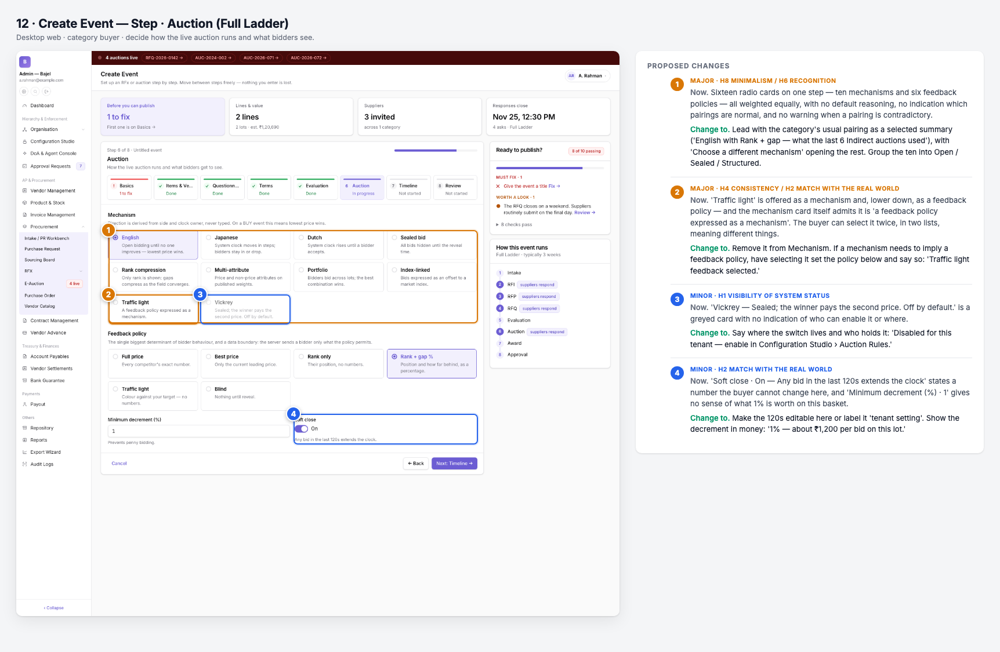

1. **Major · H8 Minimalism / H6 Recognition**  
   *Now.* Sixteen radio cards on one step — ten mechanisms and six feedback policies — all weighted equally, with no default reasoning, no indication which pairings are normal, and no warning when a pairing is contradictory.  
   *Change to.* Lead with the category's usual pairing as a selected summary ('English with Rank + gap — what the last 6 Indirect auctions used'), with 'Choose a different mechanism' opening the rest. Group the ten into Open / Sealed / Structured.

2. **Major · H4 Consistency / H2 Match with the real world**  
   *Now.* 'Traffic light' is offered as a mechanism and, lower down, as a feedback policy — and the mechanism card itself admits it is 'a feedback policy expressed as a mechanism'. The buyer can select it twice, in two lists, meaning different things.  
   *Change to.* Remove it from Mechanism. If a mechanism needs to imply a feedback policy, have selecting it set the policy below and say so: 'Traffic light feedback selected.'

3. **Minor · H1 Visibility of system status**  
   *Now.* 'Vickrey — Sealed; the winner pays the second price. Off by default.' is a greyed card with no indication of who can enable it or where.  
   *Change to.* Say where the switch lives and who holds it: 'Disabled for this tenant — enable in Configuration Studio › Auction Rules.'

4. **Minor · H2 Match with the real world**  
   *Now.* 'Soft close · On — Any bid in the last 120s extends the clock' states a number the buyer cannot change here, and 'Minimum decrement (%) · 1' gives no sense of what 1% is worth on this basket.  
   *Change to.* Make the 120s editable here or label it 'tenant setting'. Show the decrement in money: '1% — about ₹1,200 per bid on this lot.'

## Event workspace

The fifteen tabs of a published event, from setup to award.

### 13 · Event Workspace — Overview

*Desktop web · category buyer · the home of a published event: where is it, and what do I do next.*

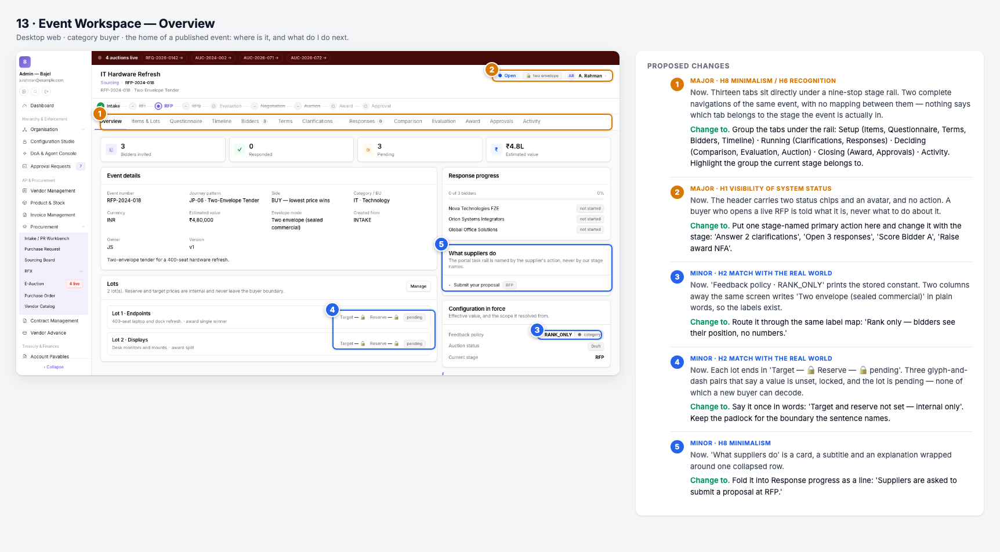

1. **Major · H8 Minimalism / H6 Recognition**  
   *Now.* Thirteen tabs sit directly under a nine-stop stage rail. Two complete navigations of the same event, with no mapping between them — nothing says which tab belongs to the stage the event is actually in.  
   *Change to.* Group the tabs under the rail: Setup (Items, Questionnaire, Terms, Bidders, Timeline) · Running (Clarifications, Responses) · Deciding (Comparison, Evaluation, Auction) · Closing (Award, Approvals) · Activity. Highlight the group the current stage belongs to.

2. **Major · H1 Visibility of system status**  
   *Now.* The header carries two status chips and an avatar, and no action. A buyer who opens a live RFP is told what it is, never what to do about it.  
   *Change to.* Put one stage-named primary action here and change it with the stage: 'Answer 2 clarifications', 'Open 3 responses', 'Score Bidder A', 'Raise award NFA'.

3. **Minor · H2 Match with the real world**  
   *Now.* 'Feedback policy · RANK_ONLY' prints the stored constant. Two columns away the same screen writes 'Two envelope (sealed commercial)' in plain words, so the labels exist.  
   *Change to.* Route it through the same label map: 'Rank only — bidders see their position, no numbers.'

4. **Minor · H2 Match with the real world**  
   *Now.* Each lot ends in 'Target — 🔒 Reserve — 🔒 pending'. Three glyph-and-dash pairs that say a value is unset, locked, and the lot is pending — none of which a new buyer can decode.  
   *Change to.* Say it once in words: 'Target and reserve not set — internal only'. Keep the padlock for the boundary the sentence names.

5. **Minor · H8 Minimalism**  
   *Now.* 'What suppliers do' is a card, a subtitle and an explanation wrapped around one collapsed row.  
   *Change to.* Fold it into Response progress as a line: 'Suppliers are asked to submit a proposal at RFP.'

### 14 · Event Workspace — Items & Lots

*Desktop web · category buyer · check what is being sourced and set per-lot price controls.*

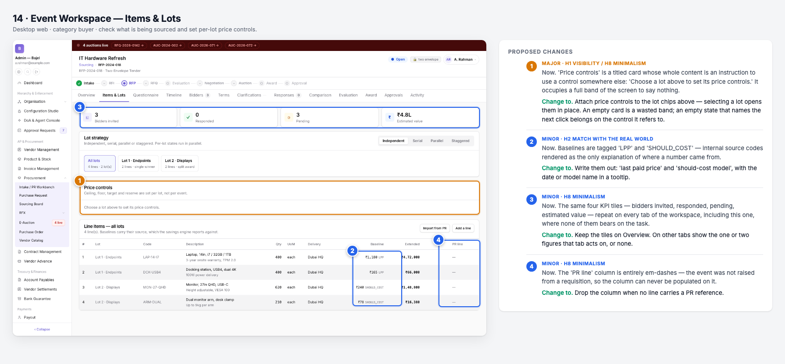

1. **Major · H1 Visibility / H8 Minimalism**  
   *Now.* 'Price controls' is a titled card whose whole content is an instruction to use a control somewhere else: 'Choose a lot above to set its price controls.' It occupies a full band of the screen to say nothing.  
   *Change to.* Attach price controls to the lot chips above — selecting a lot opens them in place. An empty card is a wasted band; an empty state that names the next click belongs on the control it refers to.

2. **Minor · H2 Match with the real world**  
   *Now.* Baselines are tagged 'LPP' and 'SHOULD_COST' — internal source codes rendered as the only explanation of where a number came from.  
   *Change to.* Write them out: 'last paid price' and 'should-cost model', with the date or model name in a tooltip.

3. **Minor · H8 Minimalism**  
   *Now.* The same four KPI tiles — bidders invited, responded, pending, estimated value — repeat on every tab of the workspace, including this one, where none of them bears on the task.  
   *Change to.* Keep the tiles on Overview. On other tabs show the one or two figures that tab acts on, or none.

4. **Minor · H8 Minimalism**  
   *Now.* The 'PR line' column is entirely em-dashes — the event was not raised from a requisition, so the column can never be populated on it.  
   *Change to.* Drop the column when no line carries a PR reference.

### 15 · Event Workspace — Questionnaire

*Desktop web · category buyer / evaluator · review and adjust what suppliers were asked.*

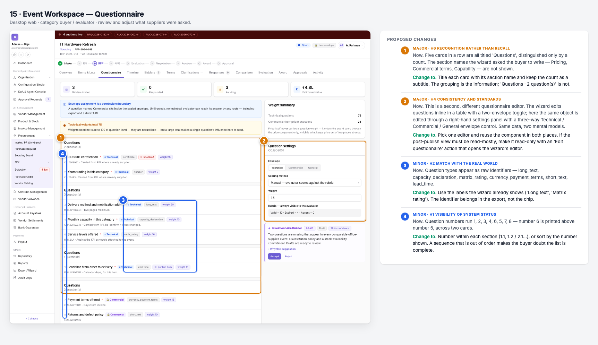

1. **Major · H6 Recognition rather than recall**  
   *Now.* Five cards in a row are all titled 'Questions', distinguished only by a count. The section names the wizard asked the buyer to write — Pricing, Commercial terms, Capability — are not shown.  
   *Change to.* Title each card with its section name and keep the count as a subtitle. The grouping is the information; 'Questions · 2 question(s)' is not.

2. **Major · H4 Consistency and standards**  
   *Now.* This is a second, different questionnaire editor. The wizard edits questions inline in a table with a two-envelope toggle; here the same object is edited through a right-hand settings panel with a three-way Technical / Commercial / General envelope control. Same data, two mental models.  
   *Change to.* Pick one editor and reuse the component in both places. If the post-publish view must be read-mostly, make it read-only with an 'Edit questionnaire' action that opens the wizard's editor.

3. **Minor · H2 Match with the real world**  
   *Now.* Question types appear as raw identifiers — long_text, capacity_declaration, matrix_rating, currency_payment_terms, short_text, lead_time.  
   *Change to.* Use the labels the wizard already shows ('Long text', 'Matrix rating'). The identifier belongs in the export, not the chip.

4. **Minor · H1 Visibility of system status**  
   *Now.* Question numbers run 1, 2, 3, 4, 6, 5, 7, 8 — number 6 is printed above number 5, across two cards.  
   *Change to.* Number within each section (1.1, 1.2 / 2.1…), or sort by the number shown. A sequence that is out of order makes the buyer doubt the list is complete.

### 16 · Event Workspace — Timeline

*Desktop web · category buyer · see the deadlines in force and extend one if needed.*

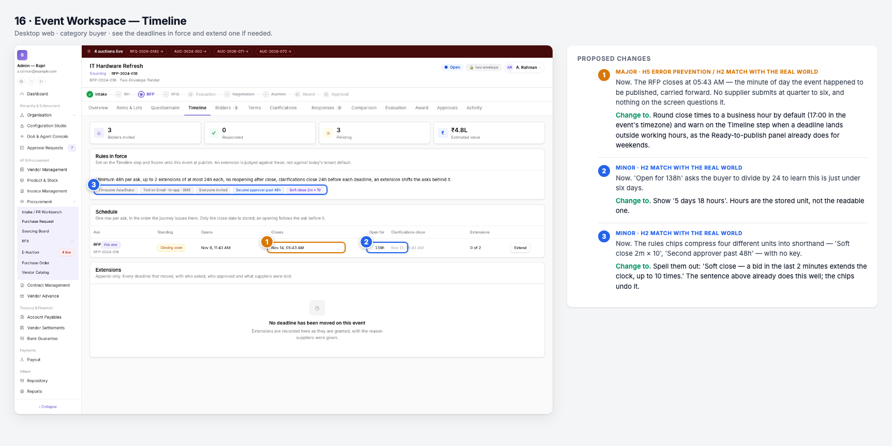

1. **Major · H5 Error prevention / H2 Match with the real world**  
   *Now.* The RFP closes at 05:43 AM — the minute of day the event happened to be published, carried forward. No supplier submits at quarter to six, and nothing on the screen questions it.  
   *Change to.* Round close times to a business hour by default (17:00 in the event's timezone) and warn on the Timeline step when a deadline lands outside working hours, as the Ready-to-publish panel already does for weekends.

2. **Minor · H2 Match with the real world**  
   *Now.* 'Open for 138h' asks the buyer to divide by 24 to learn this is just under six days.  
   *Change to.* Show '5 days 18 hours'. Hours are the stored unit, not the readable one.

3. **Minor · H2 Match with the real world**  
   *Now.* The rules chips compress four different units into shorthand — 'Soft close 2m × 10', 'Second approver past 48h' — with no key.  
   *Change to.* Spell them out: 'Soft close — a bid in the last 2 minutes extends the clock, up to 10 times.' The sentence above already does this well; the chips undo it.

### 17 · Event Workspace — Bidders

*Desktop web · category buyer · see who was invited, who accepted, and invite more.*

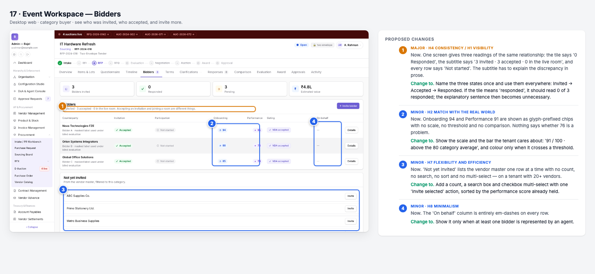

1. **Major · H4 Consistency / H1 Visibility**  
   *Now.* One screen gives three readings of the same relationship: the tile says '0 Responded', the subtitle says '3 invited · 3 accepted · 0 in the live room', and every row says 'Not started'. The subtitle has to explain the discrepancy in prose.  
   *Change to.* Name the three states once and use them everywhere: Invited → Accepted → Responded. If the tile means 'responded', it should read 0 of 3 responded; the explanatory sentence then becomes unnecessary.

2. **Minor · H2 Match with the real world**  
   *Now.* Onboarding 94 and Performance 91 are shown as glyph-prefixed chips with no scale, no threshold and no comparison. Nothing says whether 76 is a problem.  
   *Change to.* Show the scale and the bar the tenant cares about: '91 / 100 · above the 80 category average', and colour only when it crosses a threshold.

3. **Minor · H7 Flexibility and efficiency**  
   *Now.* 'Not yet invited' lists the vendor master one row at a time with no count, no search, no sort and no multi-select — on a tenant with 20+ vendors.  
   *Change to.* Add a count, a search box and checkbox multi-select with one 'Invite selected' action, sorted by the performance score already held.

4. **Minor · H8 Minimalism**  
   *Now.* The 'On behalf' column is entirely em-dashes on every row.  
   *Change to.* Show it only when at least one bidder is represented by an agent.

### 18 · Event Workspace — Terms

*Desktop web · category buyer · check which conditions this event went out under.*

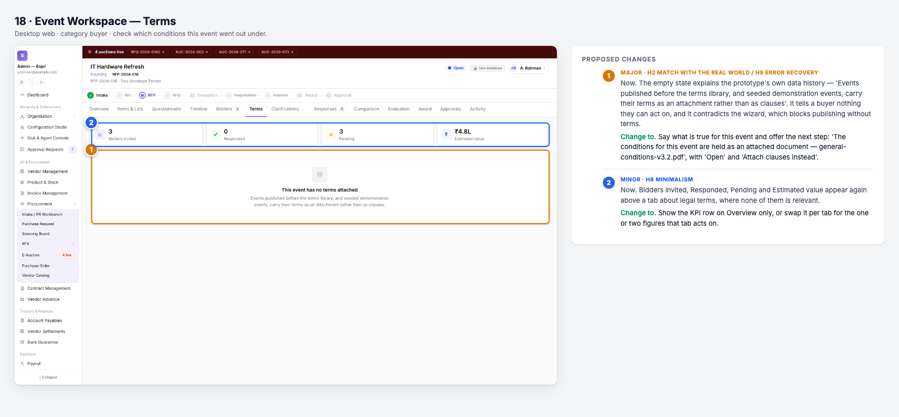

1. **Major · H2 Match with the real world / H9 Error recovery**  
   *Now.* The empty state explains the prototype's own data history — 'Events published before the terms library, and seeded demonstration events, carry their terms as an attachment rather than as clauses'. It tells a buyer nothing they can act on, and it contradicts the wizard, which blocks publishing without terms.  
   *Change to.* Say what is true for this event and offer the next step: 'The conditions for this event are held as an attached document — general-conditions-v3.2.pdf', with 'Open' and 'Attach clauses instead'.

2. **Minor · H8 Minimalism**  
   *Now.* Bidders invited, Responded, Pending and Estimated value appear again above a tab about legal terms, where none of them is relevant.  
   *Change to.* Show the KPI row on Overview only, or swap it per tab for the one or two figures that tab acts on.

### 19 · Event Workspace — Clarifications

*Desktop web · category buyer · answer supplier questions and publish the register.*

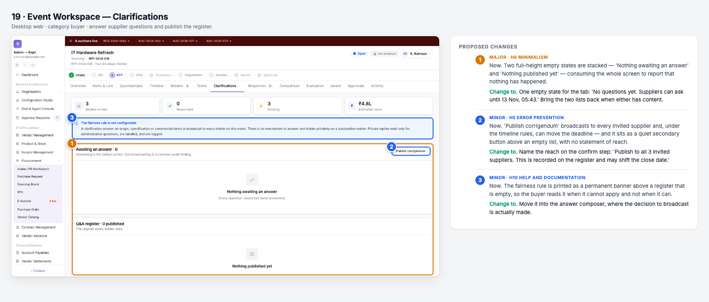

1. **Major · H8 Minimalism**  
   *Now.* Two full-height empty states are stacked — 'Nothing awaiting an answer' and 'Nothing published yet' — consuming the whole screen to report that nothing has happened.  
   *Change to.* One empty state for the tab: 'No questions yet. Suppliers can ask until 13 Nov, 05:43.' Bring the two lists back when either has content.

2. **Minor · H5 Error prevention**  
   *Now.* 'Publish corrigendum' broadcasts to every invited supplier and, under the timeline rules, can move the deadline — and it sits as a quiet secondary button above an empty list, with no statement of reach.  
   *Change to.* Name the reach on the confirm step: 'Publish to all 3 invited suppliers. This is recorded on the register and may shift the close date.'

3. **Minor · H10 Help and documentation**  
   *Now.* The fairness rule is printed as a permanent banner above a register that is empty, so the buyer reads it when it cannot apply and not when it can.  
   *Change to.* Move it into the answer composer, where the decision to broadcast is actually made.

### 20 · Event Workspace — Responses

*Desktop web · category buyer · read what came in, and unlock commercial envelopes at the right moment.*

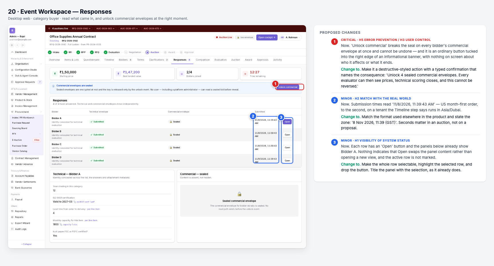

1. **Critical · H5 Error prevention / H3 User control**  
   *Now.* 'Unlock commercial' breaks the seal on every bidder's commercial envelope at once and cannot be undone — and it is an ordinary button tucked into the right edge of an informational banner, with nothing on screen about who it affects or what it ends.  
   *Change to.* Make it a destructive-styled action with a typed confirmation that names the consequence: 'Unlock 4 sealed commercial envelopes. Every evaluator can then see prices, technical scoring closes, and this cannot be reversed.'

2. **Minor · H2 Match with the real world**  
   *Now.* Submission times read '11/8/2026, 11:39:43 AM' — US month-first order, to the second, on a tenant the Timeline step says runs in Asia/Dubai.  
   *Change to.* Match the format used elsewhere in the product and state the zone: '8 Nov 2026, 11:39 (GST)'. Seconds matter in an auction, not on a proposal.

3. **Minor · H1 Visibility of system status**  
   *Now.* Each row has an 'Open' button and the panels below already show Bidder A. Nothing indicates that Open swaps the panel content rather than opening a new view, and the active row is not marked.  
   *Change to.* Make the whole row selectable, highlight the selected row, and drop the button. Title the panel with the selection, as it already does.

### 21 · Event Workspace — Comparison

*Desktop web · category buyer · put the responses side by side and rank them.*

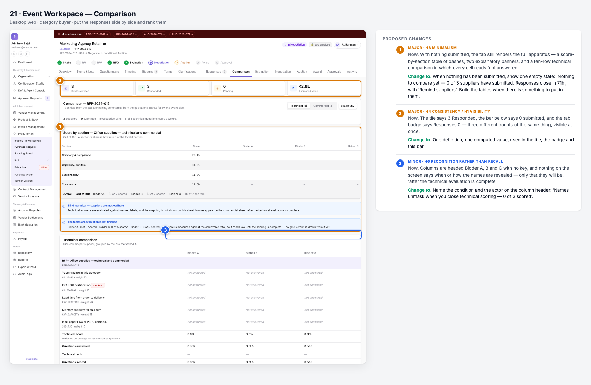

1. **Major · H8 Minimalism**  
   *Now.* With nothing submitted, the tab still renders the full apparatus — a score-by-section table of dashes, two explanatory banners, and a ten-row technical comparison in which every cell reads 'not answered'.  
   *Change to.* When nothing has been submitted, show one empty state: 'Nothing to compare yet — 0 of 3 suppliers have submitted. Responses close in 71h', with 'Remind suppliers'. Build the tables when there is something to put in them.

2. **Major · H4 Consistency / H1 Visibility**  
   *Now.* The tile says 3 Responded, the bar below says 0 submitted, and the tab badge says Responses 0 — three different counts of the same thing, visible at once.  
   *Change to.* One definition, one computed value, used in the tile, the badge and this bar.

3. **Minor · H6 Recognition rather than recall**  
   *Now.* Columns are headed Bidder A, B and C with no key, and nothing on the screen says when or how the names are revealed — only that they will be, 'after the technical evaluation is complete'.  
   *Change to.* Name the condition and the actor on the column header: 'Names unmask when you close technical scoring — 0 of 3 scored'.

### 22 · Event Workspace — Evaluation

*Desktop web · category buyer / evaluator · set the award score model and track scoring.*

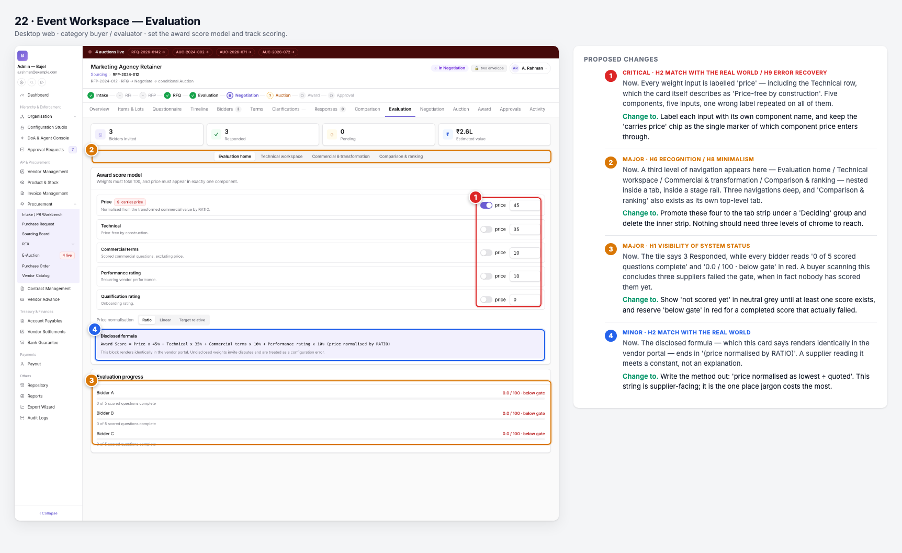

1. **Critical · H2 Match with the real world / H9 Error recovery**  
   *Now.* Every weight input is labelled 'price' — including the Technical row, which the card itself describes as 'Price-free by construction'. Five components, five inputs, one wrong label repeated on all of them.  
   *Change to.* Label each input with its own component name, and keep the 'carries price' chip as the single marker of which component price enters through.

2. **Major · H6 Recognition / H8 Minimalism**  
   *Now.* A third level of navigation appears here — Evaluation home / Technical workspace / Commercial & transformation / Comparison & ranking — nested inside a tab, inside a stage rail. Three navigations deep, and 'Comparison & ranking' also exists as its own top-level tab.  
   *Change to.* Promote these four to the tab strip under a 'Deciding' group and delete the inner strip. Nothing should need three levels of chrome to reach.

3. **Major · H1 Visibility of system status**  
   *Now.* The tile says 3 Responded, while every bidder reads '0 of 5 scored questions complete' and '0.0 / 100 · below gate' in red. A buyer scanning this concludes three suppliers failed the gate, when in fact nobody has scored them yet.  
   *Change to.* Show 'not scored yet' in neutral grey until at least one score exists, and reserve 'below gate' in red for a completed score that actually failed.

4. **Minor · H2 Match with the real world**  
   *Now.* The disclosed formula — which this card says renders identically in the vendor portal — ends in '(price normalised by RATIO)'. A supplier reading it meets a constant, not an explanation.  
   *Change to.* Write the method out: 'price normalised as lowest ÷ quoted'. This string is supplier-facing; it is the one place jargon costs the most.

### 23 · Event Workspace — Negotiation

*Desktop web · category buyer · run counter-offer rounds against a target.*

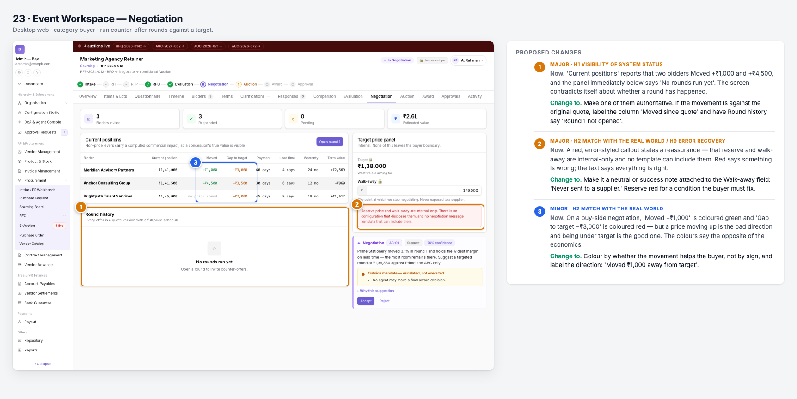

1. **Major · H1 Visibility of system status**  
   *Now.* 'Current positions' reports that two bidders Moved +₹1,000 and +₹4,500, and the panel immediately below says 'No rounds run yet'. The screen contradicts itself about whether a round has happened.  
   *Change to.* Make one of them authoritative. If the movement is against the original quote, label the column 'Moved since quote' and have Round history say 'Round 1 not opened'.

2. **Major · H2 Match with the real world / H9 Error recovery**  
   *Now.* A red, error-styled callout states a reassurance — that reserve and walk-away are internal-only and no template can include them. Red says something is wrong; the text says everything is right.  
   *Change to.* Make it a neutral or success note attached to the Walk-away field: 'Never sent to a supplier.' Reserve red for a condition the buyer must fix.

3. **Minor · H2 Match with the real world**  
   *Now.* On a buy-side negotiation, 'Moved +₹1,000' is coloured green and 'Gap to target −₹3,000' is coloured red — but a price moving up is the bad direction and being under target is the good one. The colours say the opposite of the economics.  
   *Change to.* Colour by whether the movement helps the buyer, not by sign, and label the direction: 'Moved ₹1,000 away from target'.

### 24 · Event Workspace — Auction (live cockpit)

*Desktop web · auction controller · watch a live auction and intervene if needed. Density is justified here; the issues are about consequence and duplication.*

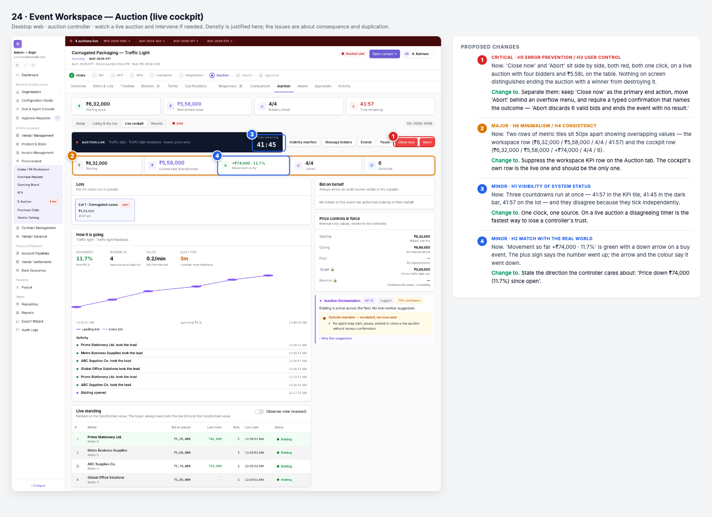

1. **Critical · H5 Error prevention / H3 User control**  
   *Now.* 'Close now' and 'Abort' sit side by side, both red, both one click, on a live auction with four bidders and ₹5.58L on the table. Nothing on screen distinguishes ending the auction with a winner from destroying it.  
   *Change to.* Separate them: keep 'Close now' as the primary end action, move 'Abort' behind an overflow menu, and require a typed confirmation that names the outcome — 'Abort discards 6 valid bids and ends the event with no result.'

2. **Major · H8 Minimalism / H4 Consistency**  
   *Now.* Two rows of metric tiles sit 50px apart showing overlapping values — the workspace row (₹6,32,000 / ₹5,58,000 / 4/4 / 41:57) and the cockpit row (₹6,32,000 / ₹5,58,000 / +₹74,000 / 4/4 / 6).  
   *Change to.* Suppress the workspace KPI row on the Auction tab. The cockpit's own row is the live one and should be the only one.

3. **Minor · H1 Visibility of system status**  
   *Now.* Three countdowns run at once — 41:57 in the KPI tile, 41:45 in the dark bar, 41:57 on the lot — and they disagree because they tick independently.  
   *Change to.* One clock, one source. On a live auction a disagreeing timer is the fastest way to lose a controller's trust.

4. **Minor · H2 Match with the real world**  
   *Now.* 'Movement so far +₹74,000 · 11.7%' is green with a down arrow on a buy event. The plus sign says the number went up; the arrow and the colour say it went down.  
   *Change to.* State the direction the controller cares about: 'Price down ₹74,000 (11.7%) since open'.

### 25 · Event Workspace — Award

*Desktop web · category buyer · pick the winner and raise the award NFA.*

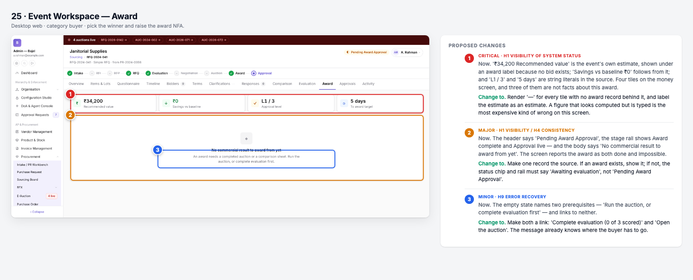

1. **Critical · H1 Visibility of system status**  
   *Now.* '₹34,200 Recommended value' is the event's own estimate, shown under an award label because no bid exists; 'Savings vs baseline ₹0' follows from it; and 'L1 / 3' and '5 days' are string literals in the source. Four tiles on the money screen, and three of them are not facts about this award.  
   *Change to.* Render '—' for every tile with no award record behind it, and label the estimate as an estimate. A figure that looks computed but is typed is the most expensive kind of wrong on this screen.

2. **Major · H1 Visibility / H4 Consistency**  
   *Now.* The header says 'Pending Award Approval', the stage rail shows Award complete and Approval live — and the body says 'No commercial result to award from yet'. The screen reports the award as both done and impossible.  
   *Change to.* Make one record the source. If an award exists, show it; if not, the status chip and rail must say 'Awaiting evaluation', not 'Pending Award Approval'.

3. **Minor · H9 Error recovery**  
   *Now.* The empty state names two prerequisites — 'Run the auction, or complete evaluation first' — and links to neither.  
   *Change to.* Make both a link: 'Complete evaluation (0 of 3 scored)' and 'Open the auction'. The message already knows where the buyer has to go.

### 26 · Event Workspace — Approvals

*Desktop web · category buyer / approver · follow the award NFA through its DoA chain.*

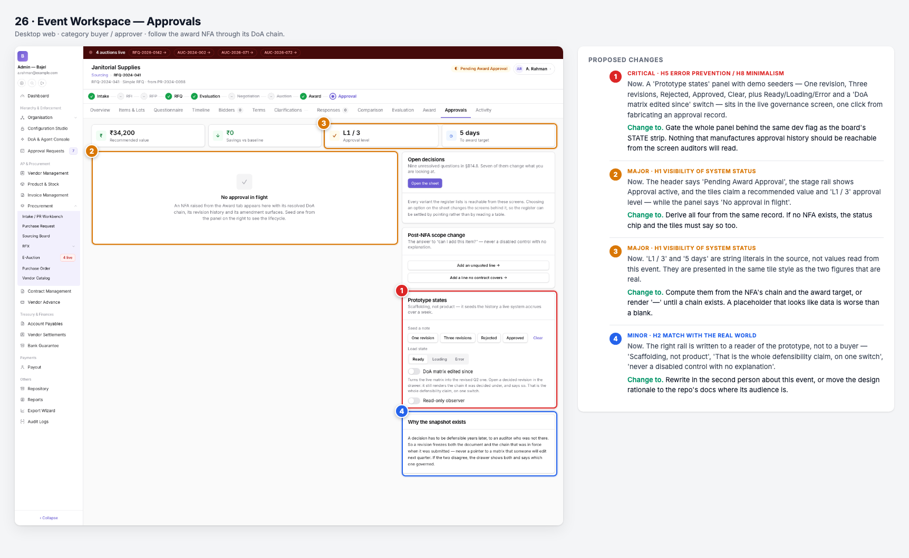

1. **Critical · H5 Error prevention / H8 Minimalism**  
   *Now.* A 'Prototype states' panel with demo seeders — One revision, Three revisions, Rejected, Approved, Clear, plus Ready/Loading/Error and a 'DoA matrix edited since' switch — sits in the live governance screen, one click from fabricating an approval record.  
   *Change to.* Gate the whole panel behind the same dev flag as the board's STATE strip. Nothing that manufactures approval history should be reachable from the screen auditors will read.

2. **Major · H1 Visibility of system status**  
   *Now.* The header says 'Pending Award Approval', the stage rail shows Approval active, and the tiles claim a recommended value and 'L1 / 3' approval level — while the panel says 'No approval in flight'.  
   *Change to.* Derive all four from the same record. If no NFA exists, the status chip and the tiles must say so too.

3. **Major · H1 Visibility of system status**  
   *Now.* 'L1 / 3' and '5 days' are string literals in the source, not values read from this event. They are presented in the same tile style as the two figures that are real.  
   *Change to.* Compute them from the NFA's chain and the award target, or render '—' until a chain exists. A placeholder that looks like data is worse than a blank.

4. **Minor · H2 Match with the real world**  
   *Now.* The right rail is written to a reader of the prototype, not to a buyer — 'Scaffolding, not product', 'That is the whole defensibility claim, on one switch', 'never a disabled control with no explanation'.  
   *Change to.* Rewrite in the second person about this event, or move the design rationale to the repo's docs where its audience is.

### 27 · Event Workspace — Activity

*Desktop web · category buyer / auditor · the append-only ledger of everything that happened to this event.*

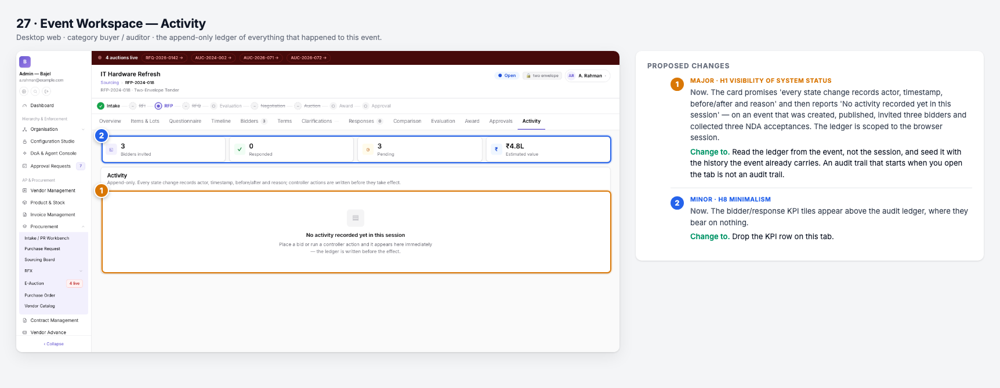

1. **Major · H1 Visibility of system status**  
   *Now.* The card promises 'every state change records actor, timestamp, before/after and reason' and then reports 'No activity recorded yet in this session' — on an event that was created, published, invited three bidders and collected three NDA acceptances. The ledger is scoped to the browser session.  
   *Change to.* Read the ledger from the event, not the session, and seed it with the history the event already carries. An audit trail that starts when you open the tab is not an audit trail.

2. **Minor · H8 Minimalism**  
   *Now.* The bidder/response KPI tiles appear above the audit ledger, where they bear on nothing.  
   *Change to.* Drop the KPI row on this tab.

## Configuration & governance

Where the rules are set and approvals are decided.

### 28 · Configuration Studio — RFX Config

*Desktop web · admin / category manager · set the 17 RFX settings at the right scope.*

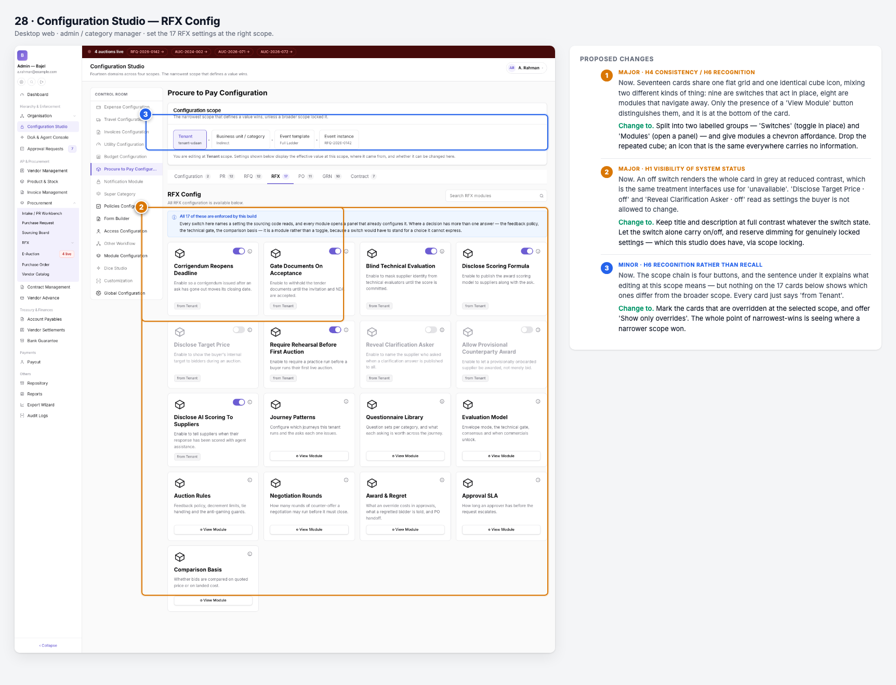

1. **Major · H4 Consistency / H6 Recognition**  
   *Now.* Seventeen cards share one flat grid and one identical cube icon, mixing two different kinds of thing: nine are switches that act in place, eight are modules that navigate away. Only the presence of a 'View Module' button distinguishes them, and it is at the bottom of the card.  
   *Change to.* Split into two labelled groups — 'Switches' (toggle in place) and 'Modules' (open a panel) — and give modules a chevron affordance. Drop the repeated cube; an icon that is the same everywhere carries no information.

2. **Major · H1 Visibility of system status**  
   *Now.* An off switch renders the whole card in grey at reduced contrast, which is the same treatment interfaces use for 'unavailable'. 'Disclose Target Price · off' and 'Reveal Clarification Asker · off' read as settings the buyer is not allowed to change.  
   *Change to.* Keep title and description at full contrast whatever the switch state. Let the switch alone carry on/off, and reserve dimming for genuinely locked settings — which this studio does have, via scope locking.

3. **Minor · H6 Recognition rather than recall**  
   *Now.* The scope chain is four buttons, and the sentence under it explains what editing at this scope means — but nothing on the 17 cards below shows which ones differ from the broader scope. Every card just says 'from Tenant'.  
   *Change to.* Mark the cards that are overridden at the selected scope, and offer 'Show only overrides'. The whole point of narrowest-wins is seeing where a narrower scope won.

### 29 · Configuration Studio — Questionnaire Library

*Desktop web · category manager / admin · author question templates and decide what each asking is worth.*

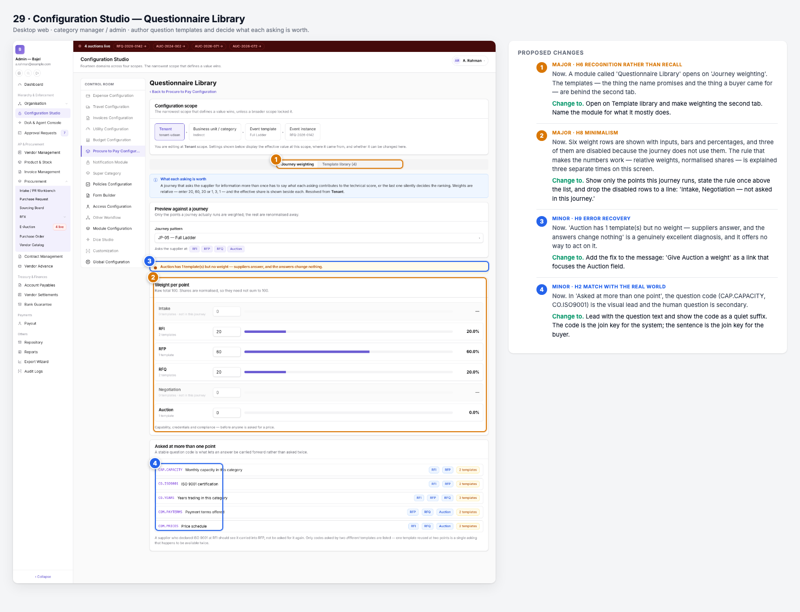

1. **Major · H6 Recognition rather than recall**  
   *Now.* A module called 'Questionnaire Library' opens on 'Journey weighting'. The templates — the thing the name promises and the thing a buyer came for — are behind the second tab.  
   *Change to.* Open on Template library and make weighting the second tab. Name the module for what it mostly does.

2. **Major · H8 Minimalism**  
   *Now.* Six weight rows are shown with inputs, bars and percentages, and three of them are disabled because the journey does not use them. The rule that makes the numbers work — relative weights, normalised shares — is explained three separate times on this screen.  
   *Change to.* Show only the points this journey runs, state the rule once above the list, and drop the disabled rows to a line: 'Intake, Negotiation — not asked in this journey.'

3. **Minor · H9 Error recovery**  
   *Now.* 'Auction has 1 template(s) but no weight — suppliers answer, and the answers change nothing' is a genuinely excellent diagnosis, and it offers no way to act on it.  
   *Change to.* Add the fix to the message: 'Give Auction a weight' as a link that focuses the Auction field.

4. **Minor · H2 Match with the real world**  
   *Now.* In 'Asked at more than one point', the question code (CAP.CAPACITY, CO.ISO9001) is the visual lead and the human question is secondary.  
   *Change to.* Lead with the question text and show the code as a quiet suffix. The code is the join key for the system; the sentence is the join key for the buyer.

### 30 · Configuration Studio — Journey Patterns

*Desktop web · admin · choose which journey patterns the tenant may use.*

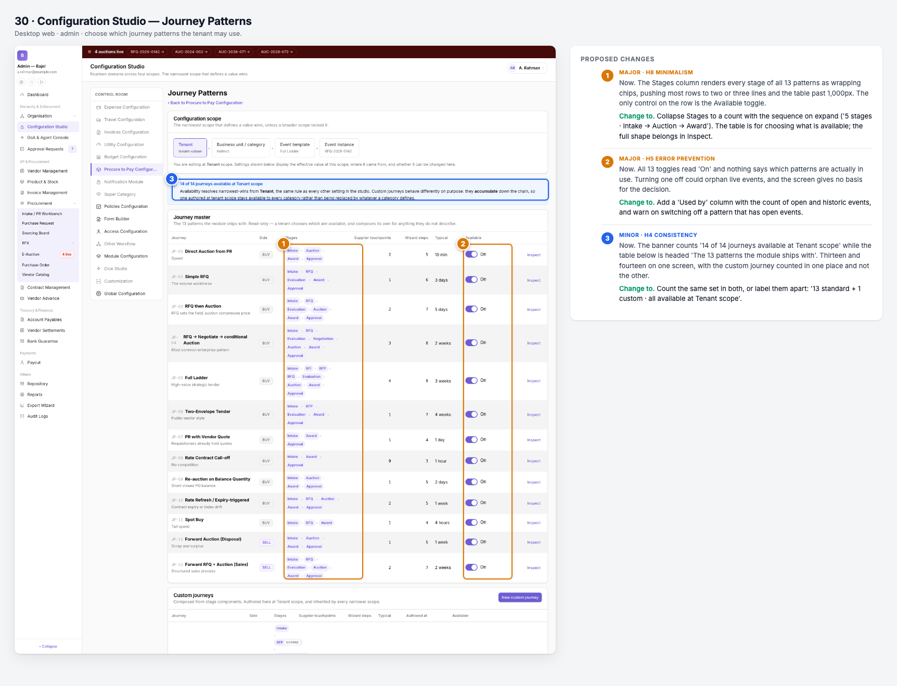

1. **Major · H8 Minimalism**  
   *Now.* The Stages column renders every stage of all 13 patterns as wrapping chips, pushing most rows to two or three lines and the table past 1,000px. The only control on the row is the Available toggle.  
   *Change to.* Collapse Stages to a count with the sequence on expand ('5 stages · Intake → Auction → Award'). The table is for choosing what is available; the full shape belongs in Inspect.

2. **Major · H5 Error prevention**  
   *Now.* All 13 toggles read 'On' and nothing says which patterns are actually in use. Turning one off could orphan live events, and the screen gives no basis for the decision.  
   *Change to.* Add a 'Used by' column with the count of open and historic events, and warn on switching off a pattern that has open events.

3. **Minor · H4 Consistency**  
   *Now.* The banner counts '14 of 14 journeys available at Tenant scope' while the table below is headed 'The 13 patterns the module ships with'. Thirteen and fourteen on one screen, with the custom journey counted in one place and not the other.  
   *Change to.* Count the same set in both, or label them apart: '13 standard + 1 custom · all available at Tenant scope'.

### 31 · DoA Matrix & Agent Console

*Desktop web · admin · check what a given award will require, and set what each agent may do.*

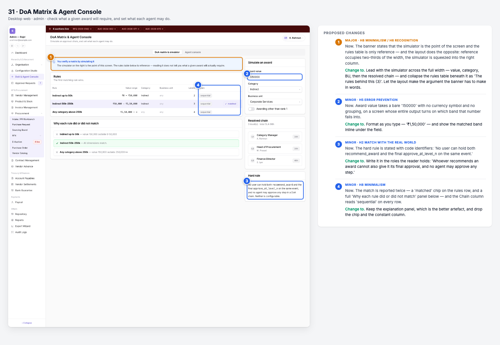

1. **Major · H8 Minimalism / H6 Recognition**  
   *Now.* The banner states that the simulator is the point of the screen and the rules table is only reference — and the layout does the opposite: reference occupies two-thirds of the width, the simulator is squeezed into the right column.  
   *Change to.* Lead with the simulator across the full width — value, category, BU, then the resolved chain — and collapse the rules table beneath it as 'The rules behind this (3)'. Let the layout make the argument the banner has to make in words.

2. **Minor · H5 Error prevention**  
   *Now.* Award value takes a bare '150000' with no currency symbol and no grouping, on a screen whose entire output turns on which band that number falls into.  
   *Change to.* Format as you type — '₹1,50,000' — and show the matched band inline under the field.

3. **Minor · H2 Match with the real world**  
   *Now.* The hard rule is stated with code identifiers: 'No user can hold both recommend_award and the final approve_at_level_n on the same event.'  
   *Change to.* Write it in the roles the reader holds: 'Whoever recommends an award cannot also give it its final approval, and no agent may approve any step.'

4. **Minor · H8 Minimalism**  
   *Now.* The match is reported twice — a 'matched' chip on the rules row, and a full 'Why each rule did or did not match' panel below — and the Chain column reads 'sequential' on every row.  
   *Change to.* Keep the explanation panel, which is the better artefact, and drop the chip and the constant column.

### 32 · Approval Requests

*Desktop web · approver (DoA holder) · the inbox of award NFAs waiting on me.*

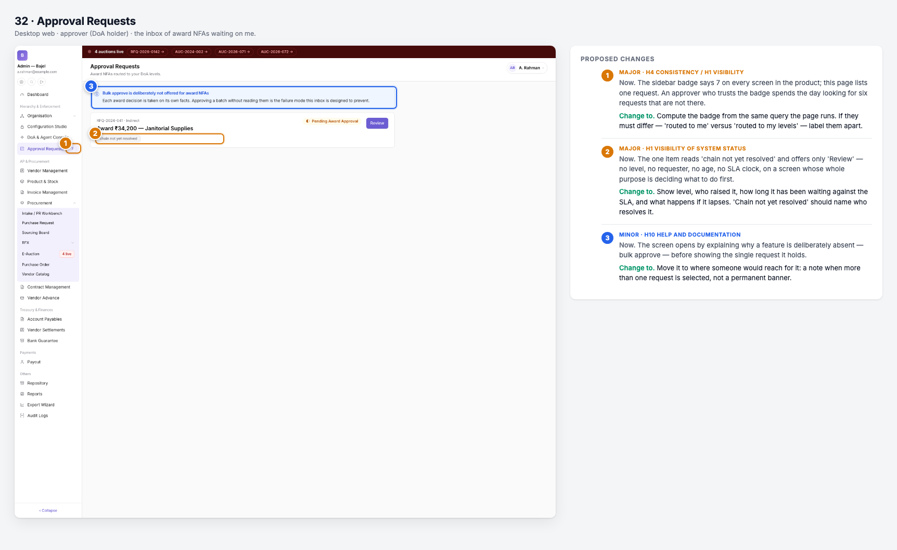

1. **Major · H4 Consistency / H1 Visibility**  
   *Now.* The sidebar badge says 7 on every screen in the product; this page lists one request. An approver who trusts the badge spends the day looking for six requests that are not there.  
   *Change to.* Compute the badge from the same query the page runs. If they must differ — 'routed to me' versus 'routed to my levels' — label them apart.

2. **Major · H1 Visibility of system status**  
   *Now.* The one item reads 'chain not yet resolved' and offers only 'Review' — no level, no requester, no age, no SLA clock, on a screen whose whole purpose is deciding what to do first.  
   *Change to.* Show level, who raised it, how long it has been waiting against the SLA, and what happens if it lapses. 'Chain not yet resolved' should name who resolves it.

3. **Minor · H10 Help and documentation**  
   *Now.* The screen opens by explaining why a feature is deliberately absent — bulk approve — before showing the single request it holds.  
   *Change to.* Move it to where someone would reach for it: a note when more than one request is selected, not a permanent banner.

### 33 · E-Auctions Board

*Desktop web · auction controller · find the auction that needs me now.*

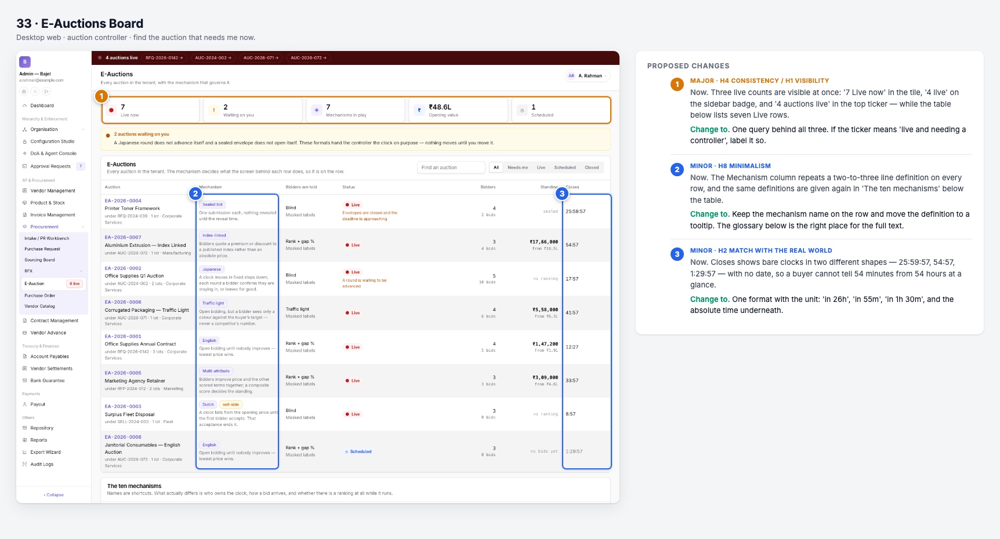

1. **Major · H4 Consistency / H1 Visibility**  
   *Now.* Three live counts are visible at once: '7 Live now' in the tile, '4 live' on the sidebar badge, and '4 auctions live' in the top ticker — while the table below lists seven Live rows.  
   *Change to.* One query behind all three. If the ticker means 'live and needing a controller', label it so.

2. **Minor · H8 Minimalism**  
   *Now.* The Mechanism column repeats a two-to-three line definition on every row, and the same definitions are given again in 'The ten mechanisms' below the table.  
   *Change to.* Keep the mechanism name on the row and move the definition to a tooltip. The glossary below is the right place for the full text.

3. **Minor · H2 Match with the real world**  
   *Now.* Closes shows bare clocks in two different shapes — 25:59:57, 54:57, 1:29:57 — with no date, so a buyer cannot tell 54 minutes from 54 hours at a glance.  
   *Change to.* One format with the unit: 'in 26h', 'in 55m', 'in 1h 30m', and the absolute time underneath.

## Supplier portal

The outside half of the product.

### 34 · Supplier Portal — Home

*Desktop web · supplier · what does this buyer need from me.*

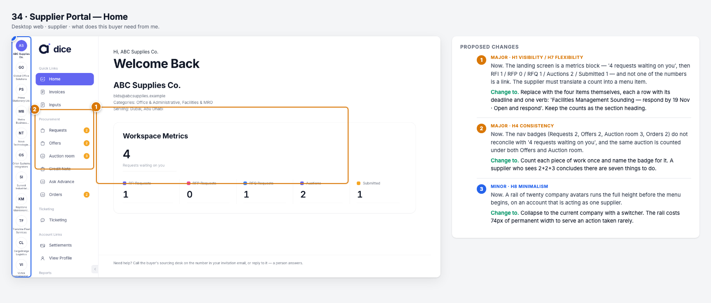

1. **Major · H1 Visibility / H7 Flexibility**  
   *Now.* The landing screen is a metrics block — '4 requests waiting on you', then RFI 1 / RFP 0 / RFQ 1 / Auctions 2 / Submitted 1 — and not one of the numbers is a link. The supplier must translate a count into a menu item.  
   *Change to.* Replace with the four items themselves, each a row with its deadline and one verb: 'Facilities Management Sounding — respond by 19 Nov · Open and respond'. Keep the counts as the section heading.

2. **Major · H4 Consistency**  
   *Now.* The nav badges (Requests 2, Offers 2, Auction room 3, Orders 2) do not reconcile with '4 requests waiting on you', and the same auction is counted under both Offers and Auction room.  
   *Change to.* Count each piece of work once and name the badge for it. A supplier who sees 2+2+3 concludes there are seven things to do.

3. **Minor · H8 Minimalism**  
   *Now.* A rail of twenty company avatars runs the full height before the menu begins, on an account that is acting as one supplier.  
   *Change to.* Collapse to the current company with a switcher. The rail costs 74px of permanent width to serve an action taken rarely.

### 35 · Supplier Portal — Requests

*Desktop web · supplier · the list of things this buyer is waiting on.*

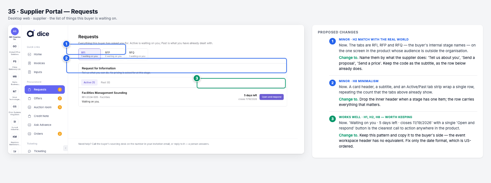

1. **Minor · H2 Match with the real world**  
   *Now.* The tabs are RFI, RFP and RFQ — the buyer's internal stage names — on the one screen in the product whose audience is outside the organisation.  
   *Change to.* Name them by what the supplier does: 'Tell us about you', 'Send a proposal', 'Send a price'. Keep the code as the subtitle, as the row below already does.

2. **Minor · H8 Minimalism**  
   *Now.* A card header, a subtitle, and an Active/Past tab strip wrap a single row, repeating the count that the tabs above already show.  
   *Change to.* Drop the inner header when a stage has one item; the row carries everything that matters.

3. **Works well · H1, H2, H8 — worth keeping**  
   *Now.* 'Waiting on you · 5 days left · closes 11/19/2026' with a single 'Open and respond' button is the clearest call to action anywhere in the product.  
   *Change to.* Keep this pattern and copy it to the buyer's side — the event workspace header has no equivalent. Fix only the date format, which is US-ordered.

### 36 · Supplier Portal — Responding to an RFI

*Desktop web · supplier · answer the questionnaire and submit before the deadline.*

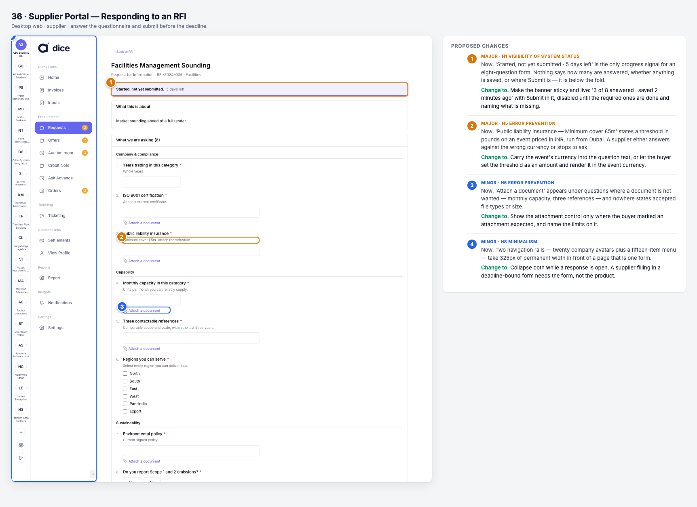

1. **Major · H1 Visibility of system status**  
   *Now.* 'Started, not yet submitted · 5 days left' is the only progress signal for an eight-question form. Nothing says how many are answered, whether anything is saved, or where Submit is — it is below the fold.  
   *Change to.* Make the banner sticky and live: '3 of 8 answered · saved 2 minutes ago' with Submit in it, disabled until the required ones are done and naming what is missing.

2. **Major · H5 Error prevention**  
   *Now.* 'Public liability insurance — Minimum cover £5m' states a threshold in pounds on an event priced in INR, run from Dubai. A supplier either answers against the wrong currency or stops to ask.  
   *Change to.* Carry the event's currency into the question text, or let the buyer set the threshold as an amount and render it in the event currency.

3. **Minor · H5 Error prevention**  
   *Now.* 'Attach a document' appears under questions where a document is not wanted — monthly capacity, three references — and nowhere states accepted file types or size.  
   *Change to.* Show the attachment control only where the buyer marked an attachment expected, and name the limits on it.

4. **Minor · H8 Minimalism**  
   *Now.* Two navigation rails — twenty company avatars plus a fifteen-item menu — take 325px of permanent width in front of a page that is one form.  
   *Change to.* Collapse both while a response is open. A supplier filling in a deadline-bound form needs the form, not the product.

### 37 · Supplier Portal — Offers

*Desktop web · supplier · the live events where my price competes in real time.*

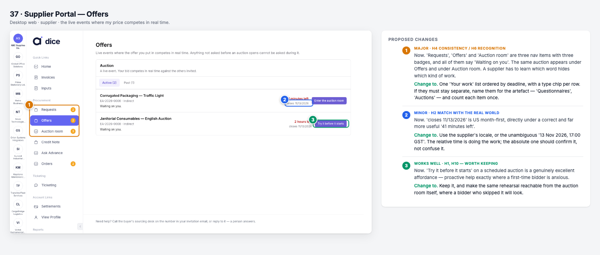

1. **Major · H4 Consistency / H6 Recognition**  
   *Now.* 'Requests', 'Offers' and 'Auction room' are three nav items with three badges, and all of them say 'Waiting on you'. The same auction appears under Offers and under Auction room. A supplier has to learn which word hides which kind of work.  
   *Change to.* One 'Your work' list ordered by deadline, with a type chip per row. If they must stay separate, name them for the artefact — 'Questionnaires', 'Auctions' — and count each item once.

2. **Minor · H2 Match with the real world**  
   *Now.* 'closes 11/13/2026' is US month-first, directly under a correct and far more useful '41 minutes left'.  
   *Change to.* Use the supplier's locale, or the unambiguous '13 Nov 2026, 17:00 GST'. The relative time is doing the work; the absolute one should confirm it, not confuse it.

3. **Works well · H1, H10 — worth keeping**  
   *Now.* 'Try it before it starts' on a scheduled auction is a genuinely excellent affordance — proactive help exactly where a first-time bidder is anxious.  
   *Change to.* Keep it, and make the same rehearsal reachable from the auction room itself, where a bidder who skipped it will look.

### 38 · Supplier Portal — Auction Room

*Desktop web · supplier · place bids in a live auction under time pressure. The strongest screen in the product.*

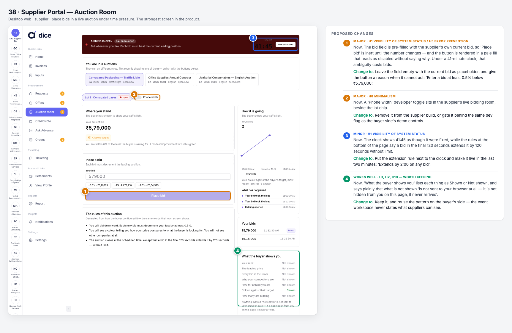

1. **Major · H1 Visibility of system status / H5 Error prevention**  
   *Now.* The bid field is pre-filled with the supplier's own current bid, so 'Place bid' is inert until the number changes — and the button is rendered in a pale fill that reads as disabled without saying why. Under a 41-minute clock, that ambiguity costs bids.  
   *Change to.* Leave the field empty with the current bid as placeholder, and give the button a reason when it cannot act: 'Enter a bid at least 0.5% below ₹5,79,000'.

2. **Major · H8 Minimalism**  
   *Now.* A 'Phone width' developer toggle sits in the supplier's live bidding room, beside the lot chip.  
   *Change to.* Remove it from the supplier build, or gate it behind the same dev flag as the buyer side's demo controls.

3. **Minor · H1 Visibility of system status**  
   *Now.* The clock shows 41:45 as though it were fixed, while the rules at the bottom of the page say a bid in the final 120 seconds extends it by 120 seconds without limit.  
   *Change to.* Put the extension rule next to the clock and make it live in the last two minutes: 'Extends by 2:00 on any bid'.

4. **Works well · H1, H2, H10 — worth keeping**  
   *Now.* 'What the buyer shows you' lists each thing as Shown or Not shown, and says plainly that what is not shown 'is not sent to your browser at all — it is not hidden from you on this page, it never arrives'.  
   *Change to.* Keep it, and reuse the pattern on the buyer's side — the event workspace never states what suppliers can see.
